<!-- GitHub shows this file as the profile page. The generated blocks come from the site's content, through tools/build-readme.mjs: change the content, not the block. Everything outside them is written by hand. -->
<!-- generated:intro -->
# DIY Eurorack from Eight4aWish

Firmware, panels, schematics and patches for a range of DIY Eurorack modules. Tutorials on aspects of vibe coding electronics, music and modular design.

[eight4awish.com](https://eight4awish.com) · [YouTube](https://www.youtube.com/@Eight4aWish) · [Buy me a coffee](https://buymeacoffee.com/eight4awish)
<!-- /generated:intro -->

## Modules

Released: each has a page and firmware to download, and the newest are still waiting for their videos.

<!-- generated:released -->
| | Module | Runs on | Version | Links |
| --- | --- | --- | --- | --- |
| <a href="https://eight4awish.com/modules/mirth-filters/">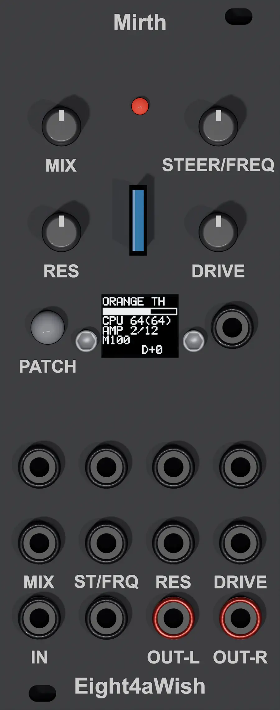</a> | **[Mirth (filters)](https://eight4awish.com/modules/mirth-filters/)** Two filters from my rack, a Doepfer Wasp and a Behringer Swords, as neural networks with cutoff and resonance as knobs, on a Daisy patch.Init(). | Patch Submodule | v1.1.0 | [Source](https://github.com/Eight4aWish/eurorack_daisy_patch_init/tree/main/daisy_neural) |
| <a href="https://eight4awish.com/modules/wish/">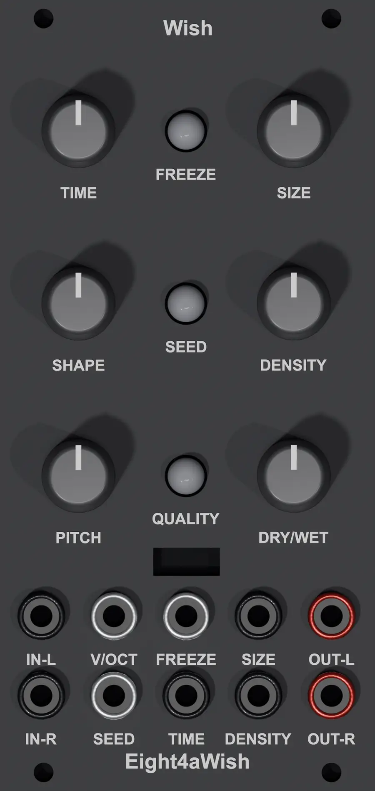</a> | **[Wish on Alchemy Lab](https://eight4awish.com/modules/wish/)** Granular textures for the Alchemy Lab, based on Mutable Instruments Beads — freeze and seed. | Alchemy Lab | v1.0.0 | [Video](https://youtu.be/D-5XmIFGvwI) · [Source](https://github.com/Eight4aWish/eurorack_daisy_patch_init/tree/main/daisy_beads) |
| <a href="https://eight4awish.com/modules/wish-patch-init/">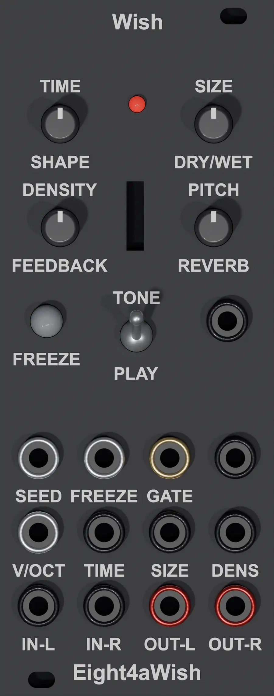</a> | **[Wish on Daisy patch.Init()](https://eight4awish.com/modules/wish-patch-init/)** Granular textures for a stock Daisy patch.Init(), based on Mutable Instruments Beads. | Patch Submodule | v1.0.0 | [Video](https://youtu.be/D-5XmIFGvwI) · [Source](https://github.com/Eight4aWish/eurorack_daisy_patch_init/tree/main/daisy_beads_patch_init) |
|  | **[Mirth (amps)](https://eight4awish.com/modules/mirth/)** Neural network amp modelling on a Daisy patch.Init() — and nineteen not-amps, captures bent inside the network to create unique effects. | Patch Submodule | v1.1.0 | [Video](https://youtu.be/pRde9nMYr3w) · [Source](https://github.com/Eight4aWish/eurorack_daisy_patch_init/tree/main/daisy_neural) |
| <a href="https://eight4awish.com/modules/secret/">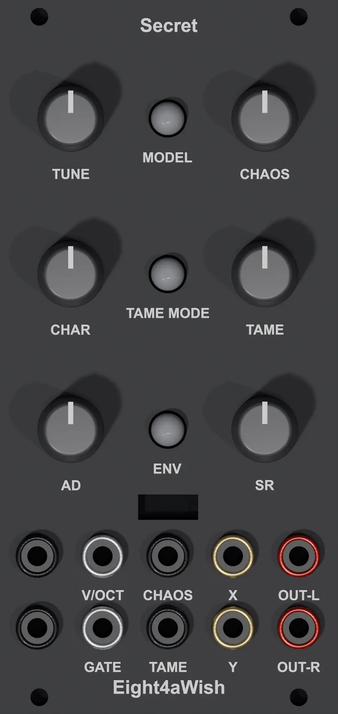</a> | **[Secret](https://eight4awish.com/modules/secret/)** A chaotic oscillator for the Alchemy Lab — twelve strange attractors, with V/oct and one knob from free chaos to a locked note. | Alchemy Lab | v1.1.0 | [Source](https://github.com/Eight4aWish/eurorack_daisy_patch_init/tree/main/daisy_chaos) |
| <a href="https://eight4awish.com/modules/tiliqua/">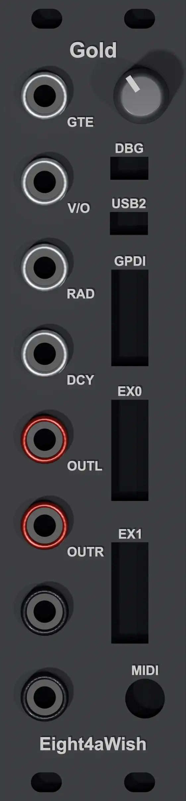</a> | **[Silver/Gold](https://eight4awish.com/modules/tiliqua/)** Two bitstream instruments for the apf.audio Tiliqua — a stereo struck drum head and stereo scanned wavetable which share a 2D mesh base. | Tiliqua | mesh-0.6 | [Video](https://youtu.be/0Uw-6slgKLg) · [Source](https://github.com/Eight4aWish/tiliqua) |
| <a href="https://eight4awish.com/modules/sorrow/">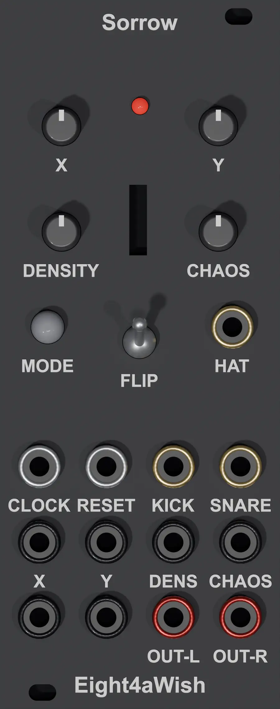</a> | **[Sorrow](https://eight4awish.com/modules/sorrow/)** A Mutable Instruments Grids based drum machine for the Daisy patch.Init() — with its own drum voices, a pool of models to roll between, and four pattern banks. | Patch Submodule | v2.4.1 | [Video](https://youtu.be/O400BdPY1MU) · [Source](https://github.com/Eight4aWish/eurorack_daisy_patch_init/tree/main/daisy_grids) |
| <a href="https://eight4awish.com/modules/joy/">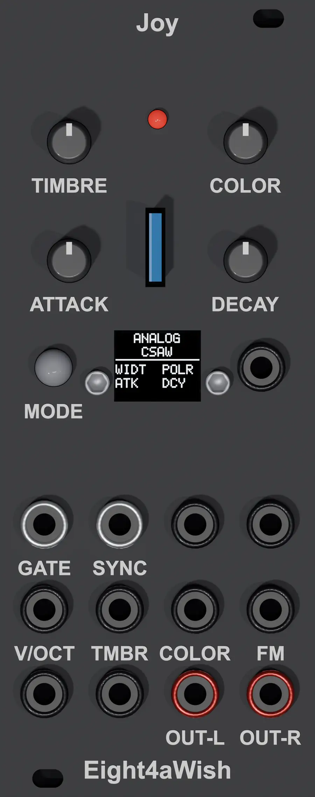</a> | **[Joy](https://eight4awish.com/modules/joy/)** A Mutable Instruments Braids based oscillator for the Daisy patch.Init() - with a screen added to facilitate patch selection. | Patch Submodule | v1.4.0 | [Video](https://youtu.be/qR6oma1cY7w) · [Source](https://github.com/Eight4aWish/eurorack_daisy_patch_init/tree/main/daisy_braids_oled) |
| <a href="https://eight4awish.com/modules/girl/">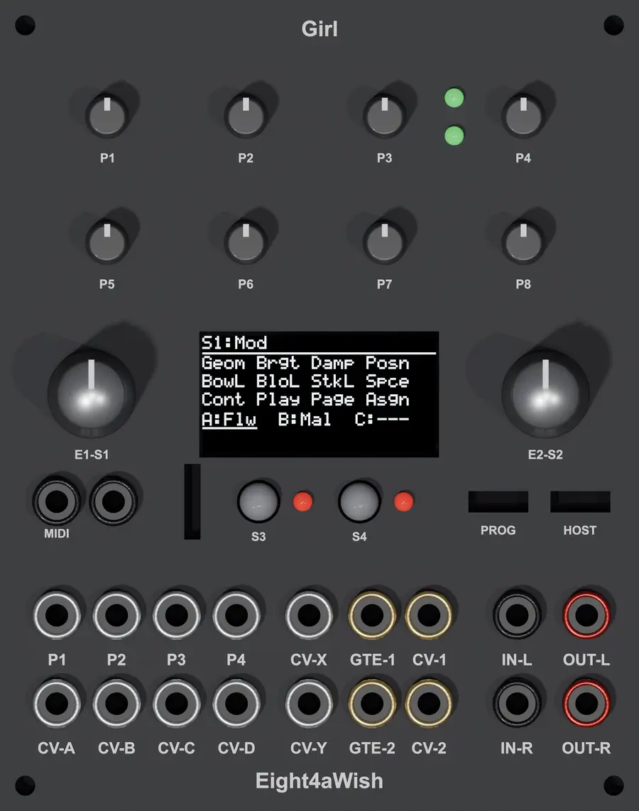</a> | **[Girl](https://eight4awish.com/modules/girl/)** A Mutable Instruments Elements based modal synthesis voice for the Ksoloti Big Genes hardware. | Ksoloti | v1.2.3 | [Video](https://youtu.be/Xg3jdBBeHSY) · [Source](https://github.com/Eight4aWish/eurorack_modules/tree/main/src/ksoloti_elements) |
<!-- /generated:released -->

### Built, with the write-up and video still to come

These are working names, and they may change.

<!-- generated:built -->
| | Module | Runs on | Links |
| --- | --- | --- | --- |
| <a href="https://github.com/Eight4aWish/eurorack_modules/tree/main/src/teensy_move">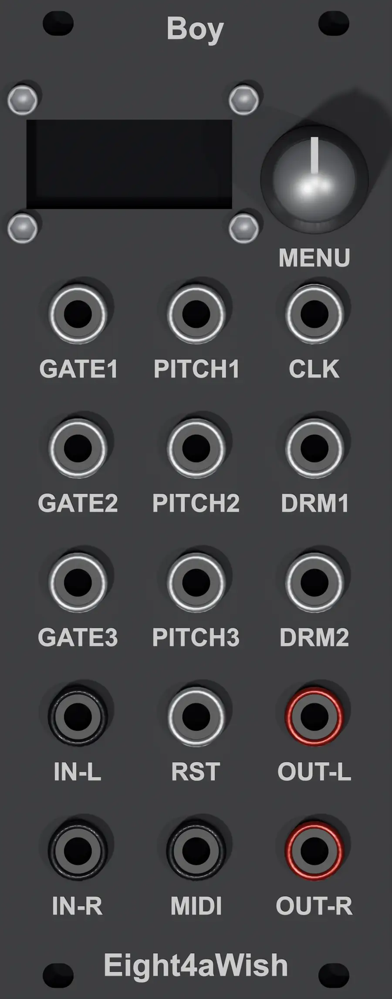</a> | **Boy** A reconfigurable platform on a Teensy 4.1: Move companion, Chordal and Warps so far. | Teensy 4.1 | [Source](https://github.com/Eight4aWish/eurorack_modules/tree/main/src/teensy_move) |
| <a href="https://github.com/Eight4aWish/eurorack_modules/tree/main/src/nanoesp32_corthex">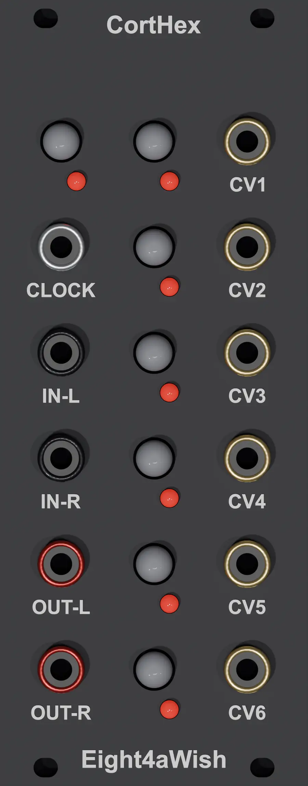</a> | **CortHex** An LLM patch generator: describe a sound in words, get six CVs of modulation. | Arduino Nano ESP32 | [Source](https://github.com/Eight4aWish/eurorack_modules/tree/main/src/nanoesp32_corthex) |
| <a href="https://github.com/Eight4aWish/eurorack_daisy_patch_init/tree/main/daisy_multiosc">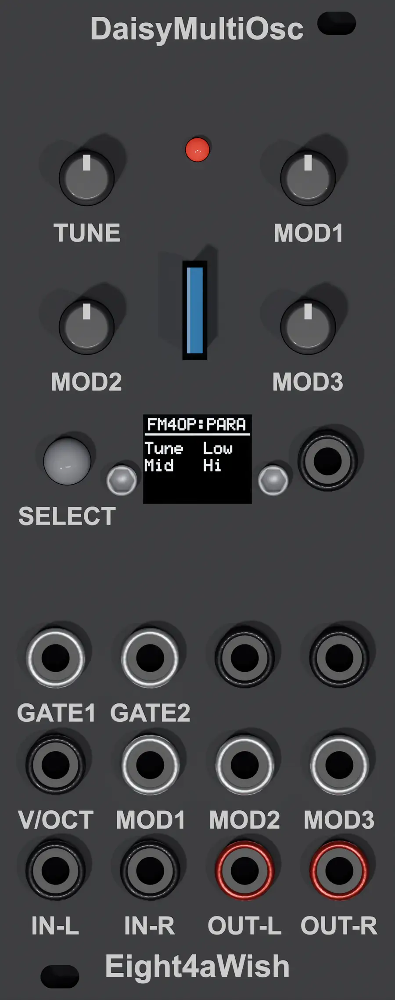</a> | **Daisy MultiOsc** A multi-voice oscillator for the Patch.Init. | Patch Submodule | [Source](https://github.com/Eight4aWish/eurorack_daisy_patch_init/tree/main/daisy_multiosc) |
| <a href="https://github.com/Eight4aWish/eurorack_daisy_patch_init/tree/main/daisy_multifx_oled">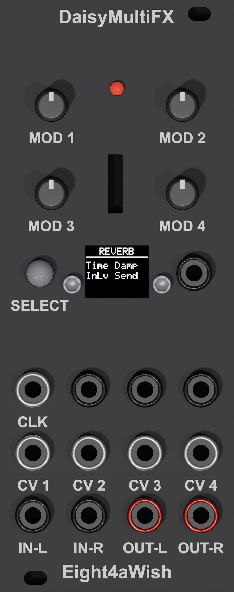</a> | **Daisy MultiFX** Multi-effects with an OLED for patch and parameter editing. | Patch Submodule | [Source](https://github.com/Eight4aWish/eurorack_daisy_patch_init/tree/main/daisy_multifx_oled) |
| <a href="https://github.com/Eight4aWish/eurorack_electronics/blob/main/docs/lpg_netlist.md">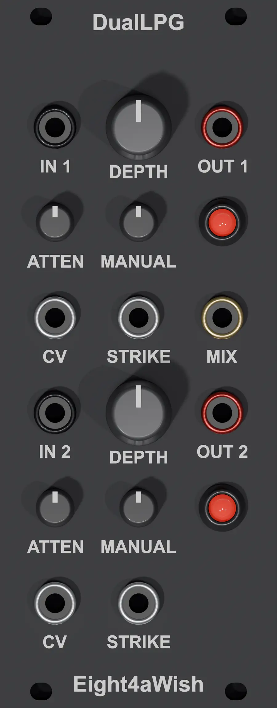</a> | **Dual Pingable LPG** A two-channel low-pass gate on the Buchla 292 audio path. | analog | [Source](https://github.com/Eight4aWish/eurorack_electronics/blob/main/docs/lpg_netlist.md) |
| <a href="https://github.com/Eight4aWish/eurorack_modules/tree/main/src/esp32_clklinkrec">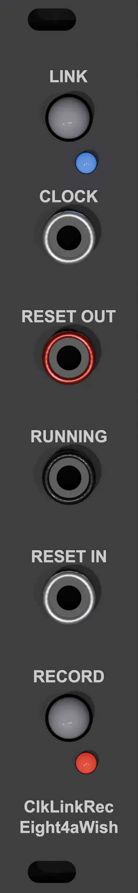</a> | **ESP32 ClkLinkRec** A clock and reset generator that syncs to Ableton Link, with a capture trigger. | XIAO ESP32-C5 | [Source](https://github.com/Eight4aWish/eurorack_modules/tree/main/src/esp32_clklinkrec) |
| <a href="https://github.com/Eight4aWish/eurorack_modules/tree/main/src/pico2w_oc">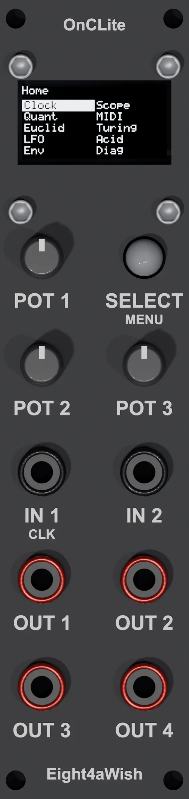</a> | **Pico2W OnC Lite** An Ornament & Crime-inspired CV utility and MIDI-to-CV interface. | Pico 2W | [Source](https://github.com/Eight4aWish/eurorack_modules/tree/main/src/pico2w_oc) |
| <a href="https://github.com/Eight4aWish/eurorack_modules/tree/main/src/amyboard_patchbank">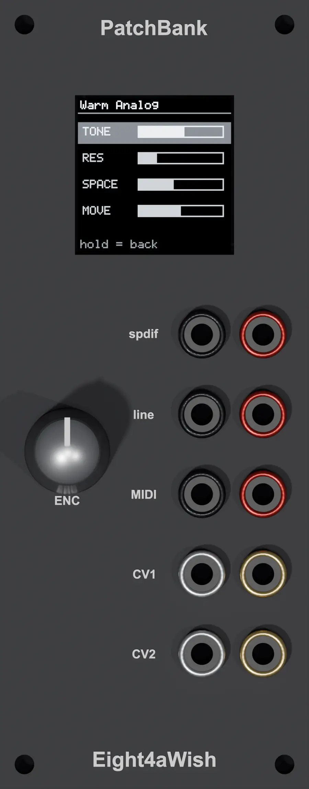</a> | **AMYboard PatchBank** A patch browser for the shorepine AMYboard synth engine. | AMYboard | [Source](https://github.com/Eight4aWish/eurorack_modules/tree/main/src/amyboard_patchbank) |
<!-- /generated:built -->

Everything built or designed, the hardware in the rack and which repo each thing lives in: [MODULES.md](MODULES.md).

## Tutorials and notes

<!-- generated:reading -->
**Tutorials**

- **[Strudel primer](https://eight4awish.com/tutorials/strudel/)**: Live-code your Eurorack from a browser tab. [Video](https://youtu.be/9yNJnmZVlNY)

**Notes**

- **[Capture your module with me](https://eight4awish.com/notes/capture-your-module/)**: Mirth plays two filters from my rack as networks, cutoff and resonance included. I would like to capture more Eurorack classics, and yours could be next.
- **[Behringer's KICK on a Mac, and what its source code reveals](https://eight4awish.com/notes/behringer-kick-source/)**: Behringer published the KICK's source before it is on sale. It did not build, so I filled the gaps, and their app now runs on my Mac. The code also shows eight CV outputs, and no code for the AI camera. [Video](https://youtu.be/mxko71HaekE)
- **[New pattern banks for Mutable Grids](https://eight4awish.com/notes/grids-patterns/)**: Sorrow's derived drum maps are the same data structure Grids uses, so they drop straight into the real module. Three new banks, but no hardware to test them on.
<!-- /generated:reading -->

## Software around the modules

**Retrospective** is a menu-bar Mac app that keeps buffering every channel of your audio interface, so a press of a button saves the last few minutes as WAV files, for when the best thing you played wasn't being recorded. A 1U USB-MIDI button, the ESP32 ClkLinkRec over WiFi, and the menu bar itself can all trigger it. It's in [seeed-recorder](https://github.com/Eight4aWish/seeed-recorder).

  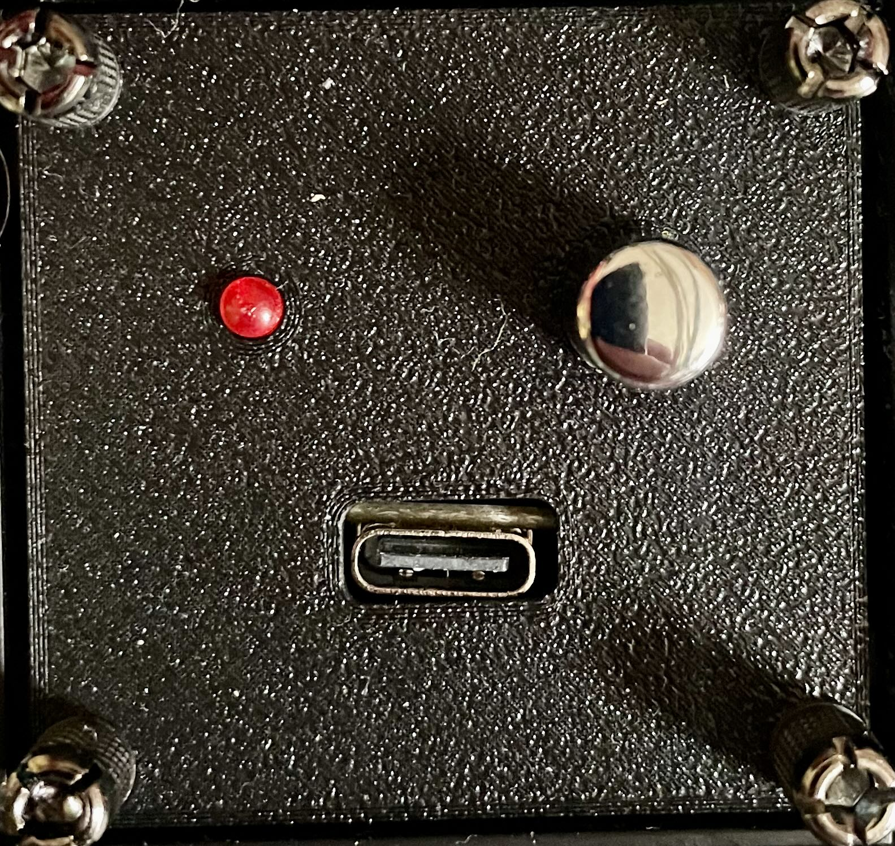
  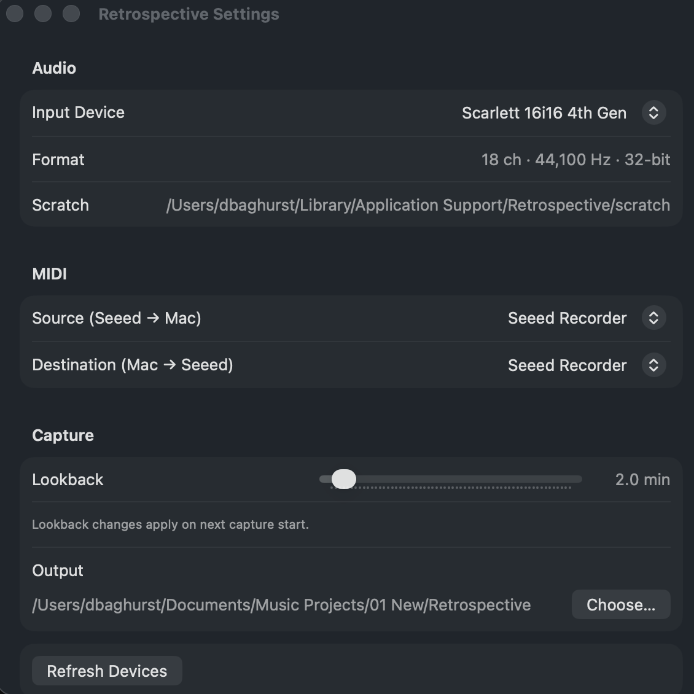

**CortHex's web app** takes a description of a sound in words and has an LLM build a bank of patches for the module's six CVs, which you can save and recall between sessions. The module and its LLM proxy are in [eurorack_modules](https://github.com/Eight4aWish/eurorack_modules/tree/main/src/nanoesp32_corthex).

  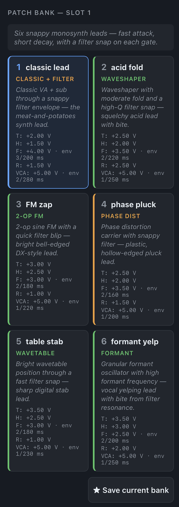

## Repositories

<!-- generated:repos -->
| Repo | What it holds |
| --- | --- |
| [eurorack_daisy_patch_init](https://github.com/Eight4aWish/eurorack_daisy_patch_init) | Firmware for the Daisy patch.Init() and the Alchemy Lab: Joy, Sorrow, Mirth, Secret, Wish and more. |
| [eurorack_modules](https://github.com/Eight4aWish/eurorack_modules) | Firmware for modules on Teensy, Pico, ESP32, Ksoloti and AMYboard: Girl, Boy, CortHex and more. |
| [eurorack_electronics](https://github.com/Eight4aWish/eurorack_electronics) | Analogue designs and breadboard layouts: the Dual Pingable LPG, and the board behind Boy. |
| [build123d](https://github.com/Eight4aWish/build123d) | Panels as code: the Eurorack front panels, plus cable and headphone holders. |
| [eight4awish](https://github.com/Eight4aWish/eight4awish) | The eight4awish.com site, this profile page, the full module inventory and the Claude skills. |
| [seeed-recorder](https://github.com/Eight4aWish/seeed-recorder) | Retrospective, a Mac app that saves the audio you just played, and its 1U trigger module. |
| [tiliqua](https://github.com/Eight4aWish/tiliqua) | Silver and Gold, bitstream instruments for the Tiliqua, on a fork of apfaudio/tiliqua. |
| [behringer-kick-macos](https://github.com/Eight4aWish/behringer-kick-macos) | Fork of the Behringer KICK (BE 0700-AAM) source: stand-ins for the unreleased modules so the KICK app builds and runs on macOS. Not affiliated with Music Tribe. |
| [ogham](https://github.com/Eight4aWish/ogham) | A fork of Ogham, a dual-voice bytebeat synth for Eurorack, with a firmware change for a substitute encoder. |
<!-- /generated:repos -->

## Claude skills

Skills for Claude that came out of this work, MIT licensed and shared as they are. More in [skills/](skills/).

<!-- generated:skills -->
- **[circuit-block-review](skills/circuit-block-review/)**: Reviews one block of a circuit (CV in, gate out, power, MIDI…) against published, proven designs before a PCB order.
- **[n8synth-layout](skills/n8synth-layout/)**: Lays a circuit out on an n8synth solderable breadboard and control deck, then checks it net by net before anything is soldered.
<!-- /generated:skills -->

## Thanks

Huge thanks to [Benjiao Modular](https://benjiaomodular.com) for their fantastic work and inspiration.

## Support

